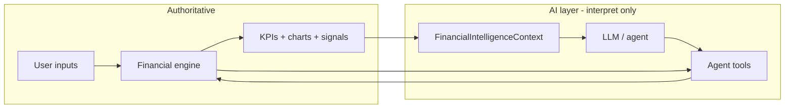
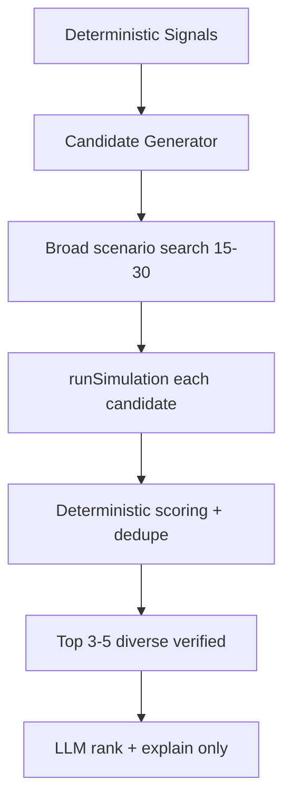
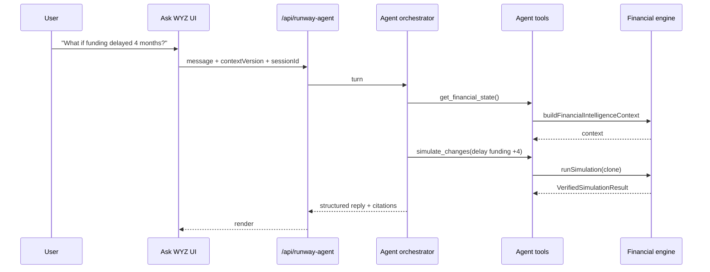
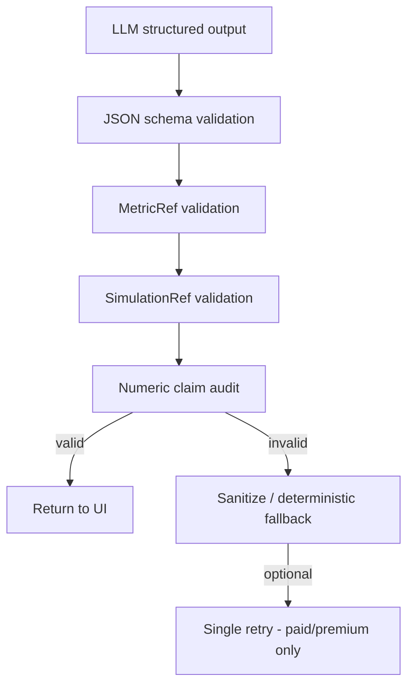
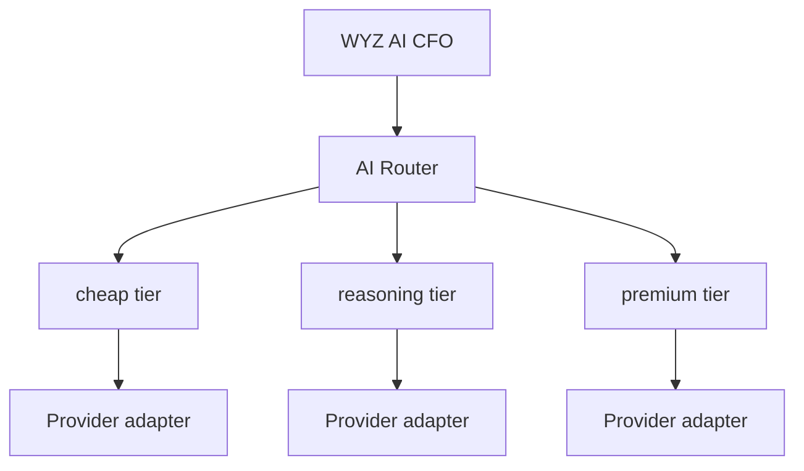
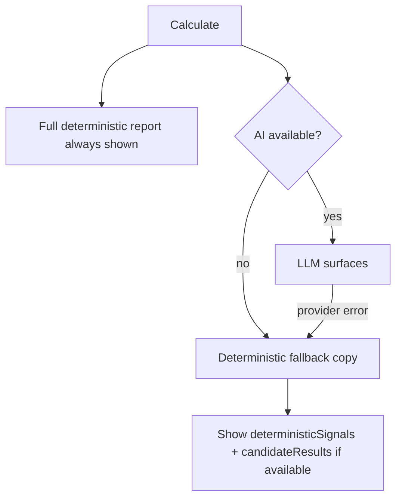
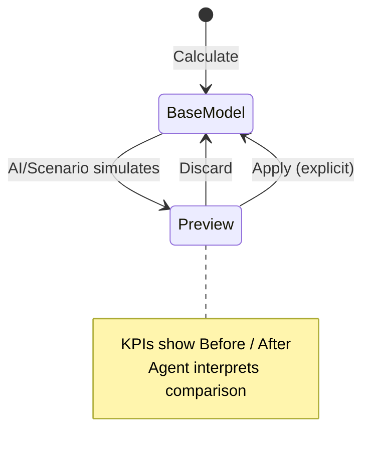

# WYZ Runway & Cash Flow Simulator — AI CFO Architecture

**Status:** Planning document (pre-implementation). Phase 0 not started.  
**Last updated:** 2026-08-12 (architecture review — provider routing, telemetry, candidate pipeline, validation gate)  
**Scope:** `/runway-simulator` results experience + financial engine under `src/lib/financial-simulator/`

---

## 1. Core principle

The deterministic WYZ financial engine is **always** the source of truth for financial calculations.

### AI must NOT calculate or invent

| Category | Examples |
|----------|----------|
| P&L | Revenue, Gross Margin, CM1, CM2, EBITDA |
| Burn | Gross Burn, Net Burn (excl/incl CapEx) |
| Cash | Closing cash, Net Cash Flow, Free Cash Flow |
| Capital | CapEx impact, funding impact |
| Runway | Headline runway, before/after funding runway, cash-series runway, cash-out dates |
| Scenarios | Any before/after metric from a what-if |
| Benchmarks | Peer ranges (unless pre-supplied from validated tables) |

### AI may

- Interpret deterministic results
- Prioritize issues and explain implications
- Select which deterministic simulations to run
- Compare deterministic scenarios
- Recommend actions **only when backed by verified simulation output**
- Answer user questions by **calling financial tools** (never by mental arithmetic)

### Product split

| Question type | Owner |
|---------------|--------|
| What happened / what will happen? | Deterministic engine |
| Why does it matter / what should I consider? | AI layer |



---

## 2. Current report architecture (audit)

Results render in `src/pages/RunwaySimulatorPage.jsx` when `phase === "results"`.  
Display model: `display = viewResult || result` (base sim vs overlay sim).

### 2.1 Section inventory

| Section | Location | Classification | Engine / logic source | Notes |
|---------|----------|----------------|----------------------|-------|
| **Runway before/after funding** | Page hero | **DETERMINISTIC** + template copy | `calculateKpis.js`, `plannedFunding.js` | Per-leg health badges; CFO before/after semantics |
| **Projected runway (no funding)** | Page hero | **DETERMINISTIC** + template copy | `computeCfoHeadlineRunwayMonths`, `findExpectedCashOutMonth` | Single hero + expected cash-out |
| **Financial Performance** | `ResultsSummaryKpis.jsx` | **DETERMINISTIC** | `calculateKpis.financialPerformance` | Month 1 revenue, GM, CM1, EBITDA |
| **Burn & Cash** | `ResultsSummaryKpis.jsx` | **DETERMINISTIC** | `calculateKpis.burnMetrics` | Net burn excl/incl CapEx, gross burn |
| **Expense Breakdown** | `SimulatorCharts.jsx` | **DETERMINISTIC** | `buildMonth1OperatingExpenseMix.js` | Month 1 pie; excludes COGS/other direct |
| **Closing Cash Position** | `SimulatorCharts.jsx` | **DETERMINISTIC** | `chartSeries.js`, `capexCashInsight.js` | 24-mo series; CapEx caption = rules |
| **Revenue vs Total Expenses** | `SimulatorCharts.jsx` | **DETERMINISTIC** | `chartSeries.js` | Operating P&L expenses; excl CapEx |
| **EBITDA Trend** | `SimulatorCharts.jsx` | **DETERMINISTIC** | `calculateProjection.js` | Rule-based caption |
| **Cash Flow Intelligence (chart)** | `CashMovementBreakdown.jsx` | **DETERMINISTIC** | Local chart builders, `buildCashFlowLegendAssumptions` | 12-mo horizon default |
| **Operating leverage stats** | `CashMovementBreakdown.jsx` | **DETERMINISTIC INTELLIGENCE** | `buildOperatingLeverageStats` | M1 vs M12 badges + rules |
| **Funding Dependency** | `CashMovementBreakdown.jsx` | **DETERMINISTIC INTELLIGENCE** | `buildFundingDependencyInsight` | Template from KPI deltas |
| **Cost Contribution** | `CashMovementBreakdown.jsx` | **DETERMINISTIC** | `buildCostContribution` | Month 1 % of revenue bars |
| **Expense Insights** | Page + CFI panel | **DETERMINISTIC INTELLIGENCE** | `buildExpenseInsights` (page), rich variant in `cashMovementInsight.js` | Rule thresholds |
| **Industry Benchmark** | `CashMovementBreakdown.jsx` | **DETERMINISTIC INTELLIGENCE** | `INDUSTRY_GROSS_MARGIN_BENCHMARKS` in `cashMovementInsight.js` | Static validated tables only |
| **AI CFO Recommendation** | `CashMovementBreakdown.jsx` | **DETERMINISTIC INTELLIGENCE** (mislabeled) | `pickOpportunity`, `buildWhatIfSensitivities` | Ranked opportunities; **no LLM** |
| **Ask AI CFO** | `AiCfoPanel.jsx` | **AGENT (rules today)** | `aiCfoEngine.js` | Regex NL → deterministic sim; **no LLM** |
| **WYZ Financial Assessment** | Page section | **HYBRID** | `POST /api/runway-insight` + `fallbackInsight.js` | **Only current real LLM call** (`gpt-4o-mini`) |
| **What If / Scenario Lab** | `WhatIfPanel.jsx` | **DETERMINISTIC** + rules insight | `runWhatIfScenario`, `compareScenario.js` | Local compare; does not replace page hero |
| **Customized WYZ CTA** | `CustomizedReportCta.jsx` | **DETERMINISTIC INTELLIGENCE** | Health/runway → conversion copy | Marketing rules |
| **Dev diagnostic** | `RunwayDevDiagnostic` | **DETERMINISTIC** | `runwayUiDiagnostic.js` | DEV only |

### 2.2 Classification legend

| Label | Meaning |
|-------|---------|
| **DETERMINISTIC** | Engine math + charts; no interpretation layer |
| **DETERMINISTIC INTELLIGENCE** | Rules, thresholds, templates, ranking — zero tokens |
| **HYBRID** | LLM narrates pre-calculated payload; must not recompute |
| **AGENT** | Multi-step tool use + conversation (target state) |
| **AI** | Direct model generation (assessment, interpretation) |

### 2.3 Existing “AI” that is not LLM

| Surface | Module | Actual mechanism |
|---------|--------|------------------|
| AI CFO Recommendation | `cashMovementInsight.js` | Pre-run sensitivities via `runWhatIfScenario`; pick best delta |
| Ask AI CFO | `aiCfoEngine.js` | `parseAiCfoQuestion` (regex) → `runAiCfoAction` → re-sim |
| Ask AI CFO (legacy) | `askAiCfo.js` | Static Q&A templates; **not wired in UI** |
| WYZ Assessment fallback | `fallbackInsight.js`, `api/runway-insight.js` | Deterministic templates when API key missing or provider fails |

### 2.4 Existing LLM integration

| Endpoint | Model | Input | Output schema |
|----------|-------|-------|---------------|
| `POST /api/runway-insight` | `gpt-4o-mini` (env override) | JSON payload built in `RunwaySimulatorPage.runCalc()` | `{ summary, keyRisks[], recommendedActions[], priorityObservation }` |

System prompt explicitly forbids inventing numbers. Client also falls back to `buildFallbackInsight` on network error.

### 2.5 Overlay architecture (today)

Three parallel mechanisms affect what the user sees:

```mermaid
flowchart TB
  Base[result: base runSimulation]

  subgraph pageOverlay [Page overlay]
    VR[viewResult]
    VM[viewMode]
    RDO[runDashboardOverlay]
    Base --> RDO --> VR
    VR --> Display[display = viewResult || result]
  end

  subgraph cfi [Cash Flow Intelligence]
    Preview[scenarioPreview - chart only]
    Simulate[Opportunity Simulate]
    Simulate --> RDO
  end

  subgraph whatif [What If panel]
    Local[runWhatIfScenario local compare]
  end

  subgraph aiCfo [AiCfoPanel]
    Ask[askAiCfo preview]
    Apply[onApplyScenario -> setResult]
    Ask --> Preview
    Apply --> Base
  end
```

| Mechanism | Mutates page KPIs? | Entry |
|-----------|-------------------|-------|
| Page overlay (`viewResult`) | Yes (temporary view) | Reset to current |
| Opportunity Simulate | Yes | `OPPORTUNITY_OVERLAYS` in `dashboardOverlays.js` |
| WhatIfPanel | No | Bottom section only |
| AiCfoPanel preview | No (chart line) | Dashed scenario closing cash |
| AiCfoPanel Apply | Yes (replaces base `result`) | Full `runSimulation` |

**Gap:** No unified scenario ID, no explicit Apply/Discard contract, no shared context object.

---

## 3. Target report architecture (recommended order)

Proposed final flow after AI layer is introduced:

| # | Section | Rationale |
|---|---------|-----------|
| 1 | **Runway & Liquidity** | Primary decision metric; answers “how long do we have?” first |
| 2 | **Financial Performance** | Month 1 economics anchor before cost detail |
| 3 | **Expense Structure** | Mix + assumptions; supports runway interpretation |
| 4 | **Financial Outlook** | Charts: closing cash, revenue vs expenses, EBITDA |
| 5 | **Cash Flow Intelligence** | Deeper 12-mo movement + leverage; still deterministic |
| 6 | **WYZ AI CFO Assessment** | Executive interpretation once user has seen facts |
| 7 | **Cost & Benchmark Intelligence** | Contribution + peer context; supports AI claims |
| 8 | **AI Recommended Actions** | Simulation-backed interventions only |
| 9 | **Ask WYZ AI CFO** | Conversational follow-up |
| 10 | **Scenario Lab** | User-driven exploration + AI interpretation on demand |
| 11 | **Paid / Customized WYZ CTA** | Conversion after value demonstrated |

**Ordering principle:** Facts → patterns → AI summary → verified actions → conversation → experimentation → upgrade.

---

## 4. AI surfaces — V1

### 4.1 WYZ AI CFO Assessment

**Replaces / evolves:** Current “WYZ Financial Assessment” (`/api/runway-insight`).

**Input:** `FinancialIntelligenceContext` (compact JSON, not raw 24-month arrays).

**Output (structured):**

- Executive summary
- What stands out (3–5 bullets)
- Key risks
- Priority actions (each must reference a simulation ID or deterministic signal ID)
- Next 90 days

**Rule:** Every number in the response must trace to a field in context or a `simulationResults[]` entry.  
**Rule:** All numeric claims pass §10.3 MetricRef validation before UI render.  
**Routing:** `modelTier: "cheap"` — application never selects provider/model directly.

### 4.2 AI CFO Recommendation

**Replaces:** `pickOpportunity` / “AI CFO Recommendation” banner in Cash Flow Intelligence.

**Pipeline (deterministic cost ≠ LLM cost):**

```
Deterministic Signals
        │
        ▼
Candidate Generator (signal-driven)
        │
        ▼
Broad deterministic scenario search (≈15–30 variations)
        │
        ▼
runSimulation() for every candidate   ← zero LLM tokens
        │
        ▼
Deterministic scoring + deduplication
        │
        ▼
Top 3–5 diverse VerifiedSimulationResult[]
        │
        ▼
LLM ranks + explains verified results only
```

**Rule:** AI may not claim “+X months runway” unless `candidateResults[i].delta.runwayMonths` exists.  
**Rule:** Do **not** cap broad deterministic exploration because of AI token budget — see §7.

### 4.3 Ask WYZ Agent

**Replaces:** `AiCfoPanel` + `aiCfoEngine.js` regex agent.

**Capabilities (V1):**

- Explain runway, burn, funding dependency
- Run `simulate_changes` for user questions
- Compare before/after from tool output
- Clarifying questions when inputs missing (e.g. cost per hire)

**Not V1:** Arbitrary code execution, persistent memory, multi-company data.

### 4.4 Scenario interpretation

**Trigger:** After Scenario Lab or agent simulation completes.

**Input:** `{ baseContextHash, scenarioId, comparison }` from deterministic diff.

**Output:** What changed, what improved, what did not, tradeoffs, whether economics vs funding timing drove the delta.

---

## 5. FinancialIntelligenceContext

**Problem today:** Each surface builds its own snapshot:

- `buildModelContext(sim)` in `aiCfoEngine.js` (partial)
- Inline payload in `RunwaySimulatorPage.runCalc()` (assessment-only)
- Ad-hoc `{ months, kpis, inputs }` passed to Cash Flow Intelligence

**Solution:** One canonical builder used by **all** AI features.

**Suggested module:** `src/lib/financial-simulator/financialIntelligenceContext.js`

**Suggested export:**

```typescript
buildFinancialIntelligenceContext({
  inputs,      // normalized SimulatorInputs
  months,      // 24-month projection
  kpis,        // post withFundingAwareRunway
  signals?,    // from signal engine
  candidates?, // from candidate engine
  meta: { contextVersion, calculatedAt }
})
```

### 5.1 Conceptual schema

```typescript
FinancialIntelligenceContext {
  meta: {
    contextVersion: string;   // hash of normalized inputs + engine version
    engineVersion: string;    // e.g. RUNWAY_FORM_SCHEMA_VERSION + git tag
    calculatedAt: string;     // ISO timestamp
    currency: string;
  };

  businessContext: {
    companyName, industry, businessModel, startupStage, mainPriority,
    forecastStartMonth, revenueMode
  };

  assumptions: {
    openingCash, revenueMode,
    // Simple mode
    currentMonthlyRevenue, monthlyRevenueGrowth,
    // Detailed mode
    currentVolume, monthlyVolumeGrowth, averageOrderValue, monthlyAovGrowth,
    // Cost %
    cogsPercent, otherDirectCostsPercent,
    productTechPercent,      // UI: Fulfillment & other variable costs
    salesMarketingPercent,
    // Fixed
    monthlyPayroll, payrollGrowth,
    otherFixedCosts, otherFixedGrowth,
    // Events
    capexEvents[], equityEvents[], debtEvents[]
  };

  currentPerformance: {
    revenue, grossProfit, grossMarginPercent,
    cm1, cm1MarginPercent, cm2, cm2MarginPercent,
    ebitda, ebitdaMarginPercent
  };  // Month 1 from kpis.financialPerformance + months[0]

  burnAndCash: {
    grossBurn, netBurnExclCapex, netBurnInclCapex,
    month1ClosingCash, month1OpeningCash
  };

  runway: {
    // Canonical hero fields — see §11
    primaryRunwayMonths,           // hero number shown to user
    primaryRunwayLabel,            // "projected" | "after_planned_funding"
    headlineRunwayMonths,          // CFO M1 ÷ 3-mo burn (no funding strip)
    runwayBeforePlannedFundingMonths,
    runwayAfterPlannedFundingMonths,
    cashSeriesRunwayMonths,        // analysis only — never hero when funding exists
    cashOutMonthLabel,
    cashOutMonthIndex,
    cashOutBeforeFunding,          // from cfoFundingRunway.runwayBeforeFunding
    cashOutWithFunding,            // from cfoFundingRunway.runwayAfterFunding
    healthStatus,
    healthStatusBeforePlannedFunding,
    healthStatusAfterPlannedFunding,
    fundingRunwayImpactMonths
  };

  costStructure: {
    legendAssumptions,             // buildCashFlowLegendAssumptions
    expenseMix,                    // Month 1 operating mix
    costContribution,              // buildCostContribution
    largestDriver: { key, label, shareOfRevenue }
  };

  funding: {
    plannedFunding,                // summarizePlannedFunding
    fundingDependencyInsight,      // pre-rendered template or null
    cfoFundingRunway
  };

  capex: {
    events, cumulativeMonth1, cumulativeHorizon,
    capexComparison                // incl/excl series metadata
  };

  trends: {
    // Compact summaries — not 24 monthly rows
    revenue: { m1, m6, m12, m24, cagrApprox },
    totalOperatingExpenses: { m1, m12, m24 },
    ebitda: { m1, m12, m24, firstPositiveMonth? },
    closingCash: { m1, m6, m12, m24, minimum, minimumMonth }
  };

  benchmarks: {
    available, industry, grossMarginBenchmark, onTarget, message
  };

  deterministicSignals: Signal[];  // §6

  candidateActions: CandidateAction[];  // §7 — metadata only until simulated

  simulationResults?: VerifiedSimulationResult[];  // populated before AI recommendation
}
```

### 5.2 Field → authoritative source map

| Context field | Authoritative source |
|---------------|---------------------|
| `assumptions.*` | `normalizeFormInputs()` output |
| `currentPerformance.*` | `calculateKpis().financialPerformance`, `months[0]` |
| `burnAndCash.*` | `calculateKpis().burnMetrics`, `months[0]` |
| `runway.headlineRunwayMonths` | `computeCfoHeadlineRunwayMonths(months)` |
| `runway.runwayBeforePlannedFundingMonths` | `withFundingAwareRunway` → stripped projection CFO M1 |
| `runway.runwayAfterPlannedFundingMonths` | `computeCfoRunwayAtMonth(months, firstFundingMonth-1)` |
| `runway.cashSeriesRunwayMonths` | `computeCashSeriesRunwayMonths` |
| `runway.cashOut*` | `findExpectedCashOutMonth`, `cfoFundingRunway` |
| `runway.healthStatus*` | `getHealthStatus` on appropriate runway leg |
| `costStructure.legendAssumptions` | `buildCashFlowLegendAssumptions(inputs)` |
| `costStructure.expenseMix` | `buildMonth1OperatingExpenseMix` via KPIs |
| `costStructure.costContribution` | `buildCostContribution(months[0])` |
| `funding.plannedFunding` | `summarizePlannedFunding(inputs)` |
| `capex.capexComparison` | `calculateKpis().capexComparison` |
| `trends.*` | Derived from `months[]` by reducer (no new formulas) |
| `benchmarks.*` | `buildBenchmark` in `cashMovementInsight.js` |
| `deterministicSignals` | `buildDeterministicSignals(context)` (new) |
| `candidateActions` | `buildCandidateActions(context)` (new) |

### 5.3 Context version / invalidation

```javascript
contextVersion = hashStable({
  schemaVersion: RUNWAY_FORM_SCHEMA_VERSION,
  normalizedInputs,  // full normalized object
  engineBuildId: FINANCIAL_ENGINE_VERSION,  // constant bumped on formula changes
})
```

**Invalidate AI cache when:**

- User edits form and recalculates
- User applies scenario to base model
- Engine version changes

**Do not invalidate on:** chart toggles, overlay view, scroll, rerender.

---

## 6. Deterministic signal engine

**Purpose:** Encode CFO-relevant patterns **before** any LLM call. Zero tokens.

**Suggested module:** `src/lib/financial-simulator/deterministicSignals.js`

### 6.1 Signal catalog (V1)

| Signal ID | Condition (conceptual) | Primary inputs |
|-----------|------------------------|----------------|
| `funding_dependency_high` | `plannedFunding.hasFutureFunding` && impact ≥ threshold | `fundingRunwayImpactMonths` |
| `runway_critical` | Primary runway &lt; 9 | `HEALTH_THRESHOLDS.criticalBelow` |
| `runway_caution` | 9 ≤ primary &lt; 18 | `HEALTH_THRESHOLDS.cautionBelow` |
| `runway_healthy` | Primary ≥ 18 | |
| `runway_before_funding_critical` | Before-funding leg critical when funding planned | `cfoFundingRunway` |
| `ebitda_negative_through_horizon` | All months `ebitda < 0` | `months[]` |
| `ebitda_turns_positive` | First month with `ebitda > 0` | `months[]` |
| `revenue_growing_faster_than_costs` | M1→M12 revenue Δ &gt; opex Δ | `buildOperatingLeverageStats` |
| `costs_growing_faster_than_revenue` | Negative leverage | same |
| `largest_cost_driver` | Max `costContribution.categories` | `buildCostContribution` |
| `variable_cost_load_high` | Variable share ≥ threshold | `expenseMix.variableSharePercent` |
| `fixed_cost_pressure` | Fixed share ≥ threshold | `expenseMix.fixedSharePercent` |
| `gross_margin_below_benchmark` | GM &lt; peer low | `buildBenchmark` |
| `gross_margin_at_benchmark` | GM within peer band | |
| `capex_material` | CapEx affects cash-out timing or M1 incl burn | `capexComparison` |
| `cash_out_before_funding` | Before-funding cash-out precedes first funding month | `cfoFundingRunway` |
| `cash_out_within_horizon` | `cashOutMonthIndex != null` | KPIs |
| `no_cash_out_within_horizon` | 24-mo cash stays ≥ 0 | KPIs |

### 6.2 Signal object shape

```typescript
Signal {
  id: string;
  severity: "info" | "watch" | "warn" | "critical";
  title: string;
  fact: string;           // deterministic sentence with embedded numbers
  evidence: {             // traceability for AI + tests
    source: string;     // e.g. "kpis.runwayBeforePlannedFundingMonths"
    value: number | string | boolean;
  }[];
}
```

### 6.3 Consumption

- Included in `FinancialIntelligenceContext.deterministicSignals`
- Rendered as deterministic badges (optional UI)
- Passed to LLM as **facts**, not prompts to rediscover
- Used to **filter** which candidate actions to simulate

---

## 7. Candidate action engine

**Purpose:** Generate intervention hypotheses deterministically; simulate **broadly**; score and shortlist; only then ask AI to rank the verified shortlist.

**Suggested module:** `src/lib/financial-simulator/candidateActionEngine.js`

**Reuses:** `runWhatIfScenario`, `applyCostReductionScenario`, `applyRevenueGrowthScenario`, `dashboardOverlays.js` patterns, goal-seek loops from `aiCfoEngine.js` (refactored to return structured results, not UI strings).

### 7.1 Cost separation (critical)

| Activity | Cost type |
|----------|-----------|
| `runSimulation()` for candidate exploration | **Deterministic — zero LLM tokens** |
| Broad candidate search (15–30 runs) | **CPU only — do not artificially limit for AI cost** |
| LLM ranking/explanation of shortlist | **Token cost — keep context small (3–5 candidates)** |

**Do not** conflate deterministic simulation volume with AI inference cost. The architecture intentionally runs many cheap engine simulations so the LLM receives a small set of **verified** options.

### 7.2 Pipeline



### 7.3 Candidate exploration space (examples, not hard-coded)

Generation is **signal-driven** and **validation-bound** (skip invalid input mutations). Example variation grids:

| Lever | Example variations |
|-------|-------------------|
| Fulfillment (`productTechPercent`) | −2pp, −3pp, −5pp |
| COGS | −2pp, −3pp, −5pp |
| Sales & Marketing | −2pp, −3pp, −5pp |
| Revenue growth | +0.5pp, +1pp, +2pp |
| Fixed costs | −5%, −10%, −15% |
| Payroll growth delay | 3 months, 6 months |
| CapEx timing delay | 3 months, 6 months |
| Funding timing | +N months (when funding signals present) |

Additional candidate types:

| Candidate type | Example | Input mutation |
|----------------|---------|----------------|
| `reduce_fulfillment_pts` | −5 pp fulfilment | `productTechPercent` |
| `reduce_sm_pts` | −5 pp S&M | `salesMarketingPercent` |
| `reduce_fixed_pct` | −10% fixed | payroll + otherFixed scale |
| `reduce_variable_pct` | −10% variable | S&M + fulfilment scale |
| `improve_gross_margin_pts` | +3 pp GM | `cogsPercent` decrease |
| `increase_revenue_growth` | +2 pp growth | volume/revenue growth |
| `delay_payroll_growth` | 3-mo delay | `applyPayrollDelayScenario` |
| `delay_capex` | Shift CapEx +3 mo | `capexEvents` |
| `delay_funding` | Funding +N months | `equityEvents` / `debtEvents` |

**Generation rules:**

- Always include candidates aligned with active signals (e.g. `largest_cost_driver`, `funding_dependency_high`)
- Expand grid breadth when signals indicate runway pressure — more deterministic sims, not more LLM calls
- Skip any candidate that fails `validateSimulatorInputs`
- **No artificial cap at 6–8** for deterministic exploration; cap only the **LLM-facing shortlist** (3–5)

### 7.4 Deterministic candidate scoring (pre-LLM)

Before any model call, score and filter all verified simulation results.

**Scoring dimensions (evolvable — no single magic formula yet):**

| Dimension | Purpose |
|-----------|---------|
| Runway improvement | Primary liquidity impact |
| EBITDA improvement | Operating economics |
| M12 closing cash improvement | Horizon cash position |
| Magnitude of assumption change | Penalize extreme/unrealistic moves |
| Implementation difficulty | Heuristic metadata (easy/medium/hard) |
| Signal relevance | Boost candidates addressing active `deterministicSignals` |
| Duplicate/overlap penalty | Avoid three near-identical “cut S&M” variants |

**Output:** ranked list → **diversity filter** → **top 3–5** `VerifiedSimulationResult[]` passed to LLM.

Scoring rules must be **unit-testable** and allowed to evolve independently of prompts.

### 7.5 Verified simulation result

```typescript
VerifiedSimulationResult {
  candidateId: string;
  label: string;
  difficulty: "easy" | "medium" | "hard";  // heuristic from magnitude
  assumptionChanges: { label, base, scenario }[];
  before: { runwayMonths, cashOutMonthLabel, ebitdaM1, closingCashM12 };
  after:  { runwayMonths, cashOutMonthLabel, ebitdaM1, closingCashM12 };
  delta:  { runwayMonths, cashOutMonthIndex?, ebitdaM1 };
  scenarioInputs: SimulatorInputs;  // clone — not persisted
  simulationHash: string;
  deterministicScore?: number;       // pre-LLM rank
  signalIds?: string[];              // signals this candidate addresses
}
```

**AI receives the shortlist only.** No estimated deltas. LLM must never invent candidate impact.

---

## 8. Agent tool contracts (V1)

**Suggested module:** `src/lib/financial-simulator/agentTools/` (server-side wrappers)  
**Client:** Never calls OpenAI directly; calls `/api/runway-agent` which invokes tools.

### 8.1 `get_financial_state`

| | |
|-|-|
| **Purpose** | Return compact `FinancialIntelligenceContext` for current model |
| **Input** | `{ contextVersion? }` |
| **Output** | Full context or 304 if version matches |
| **Wraps** | `buildFinancialIntelligenceContext` |
| **Mutates base** | No |
| **Free tier** | Yes |

### 8.2 `simulate_changes`

| | |
|-|-|
| **Purpose** | Run temporary scenario from structured change list |
| **Input** | `{ baseContextVersion, changes: Change[] }` |
| **Output** | `VerifiedSimulationResult` + diff summary |
| **Wraps** | `cloneInputs` → apply changes → `runSimulation` → compare |
| **Validation** | `validateSimulatorInputs`; reject out-of-bound deltas |
| **Mutates base** | **Never** — returns ephemeral scenario |
| **Free tier** | Yes, with per-session cap (e.g. 5) |

**Change schema (V1):**

```typescript
Change =
  | { type: "set_percent", field: "cogsPercent" | "productTechPercent" | ..., value: number }
  | { type: "adjust_percent", field: string, deltaPoints: number }
  | { type: "scale_fixed", percent: number }
  | { type: "shift_event", eventType: "capex" | "equity" | "debt", monthIndex: number, amount?: number }
  | { type: "apply_preset", presetId: "fixed-down-10" | "revenue-up-5" | ... }
```

### 8.3 `compare_scenarios` (optional V1)

| | |
|-|-|
| **Purpose** | Diff two stored ephemeral scenario IDs |
| **Input** | `{ baseScenarioId, comparisonScenarioId }` |
| **Output** | Metric deltas + month-level diff summary (compact) |
| **Mutates base** | No |

### 8.4 Future tools (post-V1)

| Tool | Notes |
|------|-------|
| `solve_runway_target` | Goal-seek wrapper; returns verified scenario only |
| `solve_ebitda_breakeven` | Same |
| `simulate_hiring` | Requires headcount cost input |
| `simulate_funding_delay` | Special case of `shift_event` |
| `get_monthly_projection` | Returns slice of months (e.g. M1–M12) |
| `get_cost_structure` | Sub-object of context |
| `get_benchmark_context` | Peer table for industry |

---

## 9. Agent flow



**Invariant:** The model never performs financial arithmetic. Numeric claims cite `simulationId` or `context.runway.*`.

---

## 10. Structured AI output schemas

### 10.1 AI CFO Assessment response

```typescript
AiCfoAssessment {
  executive_summary: string;          // prose — no new numbers
  top_observations: Observation[];      // max 5
  key_risks: Risk[];                    // max 5
  priority_actions: PriorityAction[];   // max 3
  next_90_days: string[];               // max 4 bullets
  meta: {
    contextVersion: string;
    model: string;
    generatedAt: string;
  };
}

Observation {
  text: string;
  signalIds?: string[];               // links to deterministicSignals
  metricRefs?: MetricRef[];             // required if text contains numbers
}

PriorityAction {
  title: string;
  rationale: string;
  simulationReference?: string;         // candidateId / simulationHash
  verified_impact_summary?: string;     // must match VerifiedSimulationResult.delta
  signalIds?: string[];
}

MetricRef {
  path: string;   // e.g. "runway.runwayBeforePlannedFundingMonths"
  value: number | string;
}
```

### 10.2 Agent turn response

```typescript
AgentTurn {
  type: "answer" | "clarify" | "simulation_result";
  message: string;
  simulation?: VerifiedSimulationResult;
  suggestedFollowUps?: string[];
  toolCalls?: { name: string; id: string }[];  // debug / audit
}
```

### 10.3 Financial validation gate (MetricRef + SimulationRef)

**Principle:** Passing JSON schema validation does **not** mean a response is financially valid. Financial validation is a **separate server-side layer** before any AI output reaches the UI.

MetricRef is **not** a prompt convention alone — it is an enforceable validation contract.

#### Example AI claim with MetricRef

```json
{
  "text": "Planned funding increases runway by 12.5 months.",
  "metricRefs": [
    {
      "path": "runway.fundingRunwayImpactMonths",
      "value": 12.5
    }
  ]
}
```

#### Validation pipeline



**Steps:**

1. **Schema validation** — required shape, types, max lengths
2. **MetricRef path allowlist** — `path` must exist on `FinancialIntelligenceContext` schema (no arbitrary paths)
3. **Authoritative value resolution** — resolve `path` from the same context object supplied to the model
4. **Value equality check** — AI `value` must match authoritative value within tolerance (e.g. display rounding: ±0.05 for months, exact for labels)
5. **SimulationRef validation** — when `simulationReference` / `candidateId` cited, must match a `VerifiedSimulationResult.simulationHash` in the request payload
6. **Numeric claim audit** — scan prose for numbers; each must bind to a MetricRef or SimulationRef
7. **Reject unsupported paths** — e.g. `runway.cashSeriesRunwayMonths` used as hero runway when funding exists

**On failure (free tier):**

- Prefer **deterministic sanitization** (strip bad numbers, replace with signal-backed template text)
- Or **deterministic fallback** (`buildFallbackInsight`, top deterministic candidate)
- **No unlimited retries** — at most one retry for premium tier on schema-only failures

**Suggested module:** `src/lib/ai/aiOutputValidator.js` (server-side only)

#### MetricRef schema

```typescript
MetricRef {
  path: string;   // allowlisted dot-path into FinancialIntelligenceContext
  value: number | string | boolean;
  displayFormat?: "months" | "currency" | "percent" | "label";
}

SimulationRef {
  candidateId: string;
  simulationHash: string;
  fields?: string[];  // e.g. ["delta.runwayMonths"]
}
```

#### Allowlist examples

| Allowed path | Forbidden misuse |
|--------------|------------------|
| `runway.runwayBeforePlannedFundingMonths` | Using `cashSeriesRunwayMonths` as “projected runway” |
| `runway.runwayAfterPlannedFundingMonths` | Inventing funding impact not in context |
| `runway.fundingRunwayImpactMonths` | |
| `runway.cashOutMonthLabel` | Deriving cash-out from runway months |
| `currentPerformance.ebitda` | Recalculating EBITDA in prose |

**UI rule:** Render numeric claims only from validated MetricRefs or SimulationRefs when validation mode is strict (production default).

---

## 11. AI recommendation safety — runway semantics

**Incident class to prevent:** Hero shows CFO after-funding **20.4** while AI mentions cash-series **26.0** or generic `runwayMonths` from wrong leg.

### 11.1 CFO-approved runway definitions (current product)

| Concept | Formula | When used |
|---------|---------|-----------|
| **Headline / projected (no funding)** | M1 ending cash ÷ forward 3-mo avg net burn (excl CapEx) | Hero “Projected Runway” |
| **Before planned funding** | Same CFO formula on projection with **equity/debt stripped**; CapEx retained | Hero top leg when funding exists |
| **After planned funding** | At **first funding month**: post-funding ending cash ÷ forward 3-mo avg net burn from that month | Hero bottom leg when funding exists |
| **Cash-series runway** | Interpolation/extrapolation on closing-cash series | Charts, CapEx comparison, horizon extension — **not hero** |
| **Expected cash-out** | First month with `closingCash < 0` | Independent of runway months |

**Health thresholds:** Critical &lt; 9 mo, Caution &lt; 18 mo, else Healthy (`defaults.js`).

### 11.2 Canonical fields for AI

All AI features MUST read runway from `FinancialIntelligenceContext.runway` only:

| UI meaning | Context path |
|------------|--------------|
| Hero single number (no funding) | `runway.primaryRunwayMonths` (= headline) |
| Before funding leg | `runway.runwayBeforePlannedFundingMonths` |
| After funding leg | `runway.runwayAfterPlannedFundingMonths` |
| Funding impact | `runway.fundingRunwayImpactMonths` |
| Cash-out (deterministic) | `runway.cashOutMonthLabel` (+ before/after variants) |
| Analysis-only extended runway | `runway.cashSeriesRunwayMonths` (explicitly labeled non-hero) |

**Forbidden:**

- Components computing their own runway for AI prompts
- AI prompts that accept raw `kpis` without normalization
- Using `cashSeriesRunwayMonths` as “projected runway” when funding exists

---

## 12. Free vs paid tiering

**Principle:** Differentiation = **model depth + company data + persistence**, not “bad AI vs good AI.” Same engine; same safety rules.

### 12.1 Free (proposed)

| Capability | Limit |
|------------|-------|
| Full deterministic report | Unlimited recalculations |
| AI CFO Assessment | 1 per calculation / contextVersion |
| AI recommendation block | Included in assessment call (combined) |
| Ask WYZ Agent | 3 questions per session |
| Agent-triggered simulations | 5 per session |
| Scenario Lab manual runs | Unlimited (deterministic) |
| AI scenario interpretation | 1 per manual scenario run |
| Persistent AI memory | None |
| Saved scenarios | None |
| Model depth | Simplified revenue (simple/detailed as today) |

### 12.2 Paid (proposed)

| Capability | Benefit |
|------------|---------|
| Persistent AI CFO thread | Continues across visits |
| Higher query + simulation limits | Practical unlimited with fair-use |
| Saved scenarios + company profiles | Named baselines |
| Real company data imports | Actuals vs forecast |
| Detailed revenue / channel model | More candidate actions |
| Working capital, hiring plans, dept budgets | Engine extensions (future) |
| Multiple funding rounds | Already partially supported |
| Target solvers | `solve_runway_target`, etc. |
| CFO-reviewed recommendations | Human-in-loop service (ops) |

---

## 13. AI cost control & usage telemetry

### 13.1 Zero model calls (deterministic work is free)

- Form entry, validation, calculate
- Entire financial engine + KPIs + charts
- Deterministic signals + **broad** candidate generation and simulation (15–30 `runSimulation()` runs — **no LLM tokens**)
- Deterministic candidate scoring, deduplication, and shortlisting
- Chart interactions, overlays, WhatIf deterministic compare
- Manual Scenario Lab calculation

**Important:** Do not reduce deterministic candidate breadth to save AI cost. Only the **LLM-facing shortlist** (3–5 verified candidates) affects token budget.

### 13.2 Call budget (free, per calculation)

| Event | Calls | Notes |
|-------|-------|-------|
| After Calculate | 1 | Assessment + recommendation ranking in single structured request |
| Ask WYZ follow-up | 1 each | Up to session cap |
| Scenario AI interpret | 1 each | On explicit user action |

### 13.3 Token control

- Send `FinancialIntelligenceContext` compact JSON (~2–4 KB target), not `months[24]`
- Trends as M1/M6/M12/M24 summaries only
- Agent pulls month detail via `get_monthly_projection` only when needed
- Response `max_tokens` caps per surface
- Assessment cache keyed by `contextVersion` — no duplicate call on rerender
- Debounce Ask WYZ input; reject parallel in-flight requests
- Pass **top 3–5 verified candidates only** to recommendation ranking — not full 15–30 grid

### 13.4 AI usage telemetry (first-class, server-authoritative)

**Purpose:** Cost observability from the first AI implementation. **No billing in V1** — internal engineering visibility only.

Telemetry must be **server-side authoritative**. Do not trust client-reported token counts or cost.

**Suggested module:** `src/lib/ai/aiUsageTelemetry.js`

#### AiUsageEvent schema

```typescript
AiUsageEvent {
  feature: "assessment" | "recommendation" | "ask_wyz" | "scenario_interpretation" | "agent_reasoning";
  provider: string;           // e.g. "openai", "deepseek", "qwen"
  model: string;              // resolved provider model id
  modelTier: "cheap" | "reasoning" | "premium";

  contextVersion: string;
  sessionId: string;

  inputTokens: number;
  outputTokens: number;

  toolCalls: number;
  simulationCalls: number;    // engine runs triggered by agent tools (not LLM cost)

  latencyMs: number;

  estimatedCostUsd: number;   // normalized from provider usage metadata

  cacheHit: boolean;

  success: boolean;
  failureReason?: string;

  timestamp: string;          // ISO-8601
}
```

**Provider adapters** normalize each provider’s usage metadata into this structure after every call.

#### Engineering cost objective (internal target)

| Target | Value |
|--------|-------|
| Free-tier fully engaged session | **< ₹1 AI inference cost** (engineering target — **not** a customer-facing promise) |

#### Metrics to measure (Phase 0.5+)

- Cost per assessment
- Cost per Ask WYZ question
- Cost per engaged free user
- Cost per converted lead/customer (when attribution available)
- Cache hit rate
- Tool calls per agent turn
- Model failure rate
- Cost vs quality by provider/model (from WYZ benchmark — see §14.3)

Telemetry events should be emitted for **cache hits** (zero cost, `cacheHit: true`) as well as live inference.

### 13.5 Fallback

See §15.

---

## 14. Model routing & WYZ benchmark

**Principle:** WYZ must remain **provider-independent**. Application code requests a **capability / logical tier**, never a hard-coded provider model.

**Suggested module:** `src/lib/ai/aiCfoService.js` (server-side only)

### 14.1 Logical model tiers



| Tier | Typical use | Examples (capability, not model names) |
|------|-------------|----------------------------------------|
| `cheap` | Assessment, simple explanations, simple agent/tool routing | Structured JSON, short prose |
| `reasoning` | Multi-tool questions, scenario reasoning, constrained strategic questions | Tool loops, comparison interpretation |
| `premium` | Complex paid CFO analysis, difficult multi-constraint reasoning | Deep reports, goal-seek narration |

**Application API (conceptual — not implemented):**

```javascript
// Request tier — NOT provider
aiCfoService.generateAssessment(context, { modelTier: "cheap" })
aiCfoService.runAgentTurn({ context, conversation, tools }, { modelTier: "reasoning" })
aiCfoService.interpretScenario({ context, comparison }, { modelTier: "reasoning" })

// Anti-pattern — do NOT call providers directly from app code
// callOpenAI(...) / callDeepSeek(...) / callQwen(...)
```

**Provider adapters** map `(modelTier, feature, locale)` → concrete `(provider, modelId)` using configuration and benchmark results.

### 14.2 AiProvider abstraction

```typescript
interface AiProvider {
  id: string;                          // e.g. "openai", "deepseek", "qwen"
  completeJson<T>(request: JsonCompletionRequest): Promise<JsonCompletionResult<T>>;
  completeWithTools(request: ToolCompletionRequest): Promise<ToolCompletionResult>;
  getModelMetadata(modelId: string): ProviderModelMetadata;
  normalizeUsage(rawUsage: unknown): NormalizedUsage;  // → AiUsageEvent fields
}

ProviderModelMetadata {
  provider: string;
  modelId: string;
  supportedTiers: ("cheap" | "reasoning" | "premium")[];
  contextWindow: number;
  supportsTools: boolean;
  supportsStructuredOutput: boolean;
  costPerInputTokenUsd?: number;
  costPerOutputTokenUsd?: number;
}
```

**Rules:**

- No provider SDK imports in React or client bundles
- Router selects adapter + model from tier + feature + tier config
- Escalation (e.g. cheap → reasoning) is router policy, not scattered `if` statements in UI

### 14.3 Phase 0.5 — WYZ AI CFO benchmark

**Purpose:** Determine the **cheapest provider/model that meets WYZ quality requirements** using **our financial scenarios**, not generic AI benchmarks.

**Candidate providers for evaluation (benchmark only — not production commitments):**

- OpenAI
- Qwen
- DeepSeek
- Optionally hosted open-weight providers

Model selection for production must be based on **WYZ benchmark scores**, not generic leaderboard rankings.

#### WyzAiEvalCase schema

```typescript
WyzAiEvalCase {
  id: string;
  financialFixture: string;           // e.g. scenario1, scenario4 golden fixture id
  userQuestion: string;
  expectedToolCalls?: string[];       // for agent cases
  expectedMetricRefs: MetricRef[];    // authoritative paths + values
  forbiddenClaims: string[];            // phrases/numbers that must not appear
  expectedFinancialRules: string[];     // e.g. "must not use cashSeriesRunwayMonths as hero"
}
```

**Initial benchmark cases** use existing approved simulator scenarios / golden fixtures.

**Example questions:**

- Why is runway 7.9 months?
- Why is runway different before and after planned funding?
- What happens if funding is delayed 4 months?
- Does CapEx affect CM1?
- What is the largest controllable cost?
- I do not want to reduce marketing. How else can I reach 15 months runway?
- Which change improves runway most?
- Why can cash-out date differ from the headline runway calculation?

#### Scoring dimensions

| # | Dimension | Gating? |
|---|-----------|---------|
| 1 | Tool-call accuracy | Yes (agent cases) |
| 2 | Numerical fidelity | **Yes — gating** |
| 3 | Runway-semantic accuracy | **Yes — gating** |
| 4 | Financial reasoning | Yes |
| 5 | Hallucination / unsupported claims | **Yes — gating** |
| 6 | Structured-output compliance | Yes |
| 7 | MetricRef correctness | **Yes — gating** |
| 8 | Latency | No (tie-breaker) |
| 9 | Cost per interaction | No (tie-breaker after quality gate) |

**Gating rule:** A cheaper model **must not win** if it produces materially worse financial answers. Financial correctness and numerical fidelity are non-negotiable.

**Suggested module:** `src/lib/ai/wyzAiBenchmark/` — fixture runner, scorers, report generator.

**CI rule:** Benchmark tests are **separate** from Excel golden tests. Golden financial tests remain completely provider-independent.

### 14.4 Configuration (conceptual)

Environment maps tiers to default adapters — populated **after** benchmark, not before:

- `WYZ_AI_TIER_CHEAP_PROVIDER` / `WYZ_AI_TIER_CHEAP_MODEL`
- `WYZ_AI_TIER_REASONING_PROVIDER` / `WYZ_AI_TIER_REASONING_MODEL`
- `WYZ_AI_TIER_PREMIUM_PROVIDER` / `WYZ_AI_TIER_PREMIUM_MODEL`

Legacy single-model env vars (e.g. current `WYZ_INSIGHT_MODEL`) migrate to tier config in Phase 0.5.

---

## 15. Failure / fallback



| Surface | On failure |
|---------|------------|
| WYZ AI Assessment | `buildFallbackInsight` + label “AI insight temporarily unavailable” if partial |
| AI Recommendation | Show top `VerifiedSimulationResult` deterministically ranked |
| Ask WYZ | “Agent temporarily unavailable — try deterministic What If” |
| Scenario interpret | Show `compareScenario` template only |

**Never:** LLM-generated numbers replacing KPIs.

---

## 16. Security

| Requirement | Implementation |
|-------------|----------------|
| API keys server-side only | Already true for `/api/runway-insight`; extend to agent route |
| Tool argument validation | JSON schema + engine validation |
| Rate limiting | Per IP + per session ID |
| Free tier quotas | Enforced server-side |
| No arbitrary tool execution | Fixed allowlist of tool names |
| Input sanitization | Strip HTML; limit string lengths in business context |
| No silent persistence | Scenarios ephemeral until explicit Apply |
| Audit log (paid) | Store tool calls + contextVersion, not full prompts (optional) |

---

## 17. State / session

### 17.1 Free session state

```typescript
RunwayAiSession {
  sessionId: string;
  contextVersion: string | null;
  assessmentCache: AiCfoAssessment | null;
  conversation: AgentMessage[];
  quotas: {
    askRemaining: number;
    simulationsRemaining: number;
  };
  ephemeralScenarios: Map<scenarioId, VerifiedSimulationResult>;
}
```

Storage: `sessionStorage` or server session — **not** localStorage (survives recalc confusion).

### 17.2 Context binding

Every AI request includes `contextVersion`. Server rejects mismatch with `409 CONTEXT_STALE` → client refreshes context and clears conversation cache.

### 17.3 Recalculate behavior

User edits inputs → new `runSimulation` → new `contextVersion` →  
invalidate: assessment cache, conversation (free), ephemeral scenarios.

---

## 18. Scenario preview / apply (target UX)



| Action | Behavior |
|--------|----------|
| **Simulate** | Create ephemeral scenario; show diff panel; optional chart preview (existing dashed line) |
| **Apply to model** | Copy `scenarioInputs` → form state → recalculate → new contextVersion |
| **Discard** | Clear ephemeral scenario |

**Applies to:** AI recommendations, Ask WYZ simulations, Scenario Lab (optional Apply).

**Current gap:** AiCfoPanel Apply immediately replaces `result` without Before/After confirmation step.

---

## 19. Implementation phases

### Phase 0 — Financial Intelligence Foundation

**Goal:** Canonical context, runway semantics, deterministic signals, broad candidate engine — **no new AI**.

| Work | Files |
|------|-------|
| `buildFinancialIntelligenceContext` | **new** `financialIntelligenceContext.js` |
| Canonical runway semantics in context | `financialIntelligenceContext.js`, `calculateKpis.js`, `plannedFunding.js` |
| `contextVersion` hash + cache hooks | **new** `contextVersion.js` |
| `buildDeterministicSignals` | **new** `deterministicSignals.js` |
| `buildCandidateActions` + **broad** batch simulate (15–30) | **new** `candidateActionEngine.js` |
| Deterministic candidate scoring + deduplication + shortlist (3–5) | `candidateActionEngine.js` |
| Deprecate duplicate payloads | `RunwaySimulatorPage.jsx`, `aiCfoEngine.js` |
| Unify runway fields for assessment payload | `RunwaySimulatorPage.runCalc()` |

**Tests:** Context mapping golden tests; signal tests; candidate breadth/deduplication/shortlist tests; stale context rejection.

**Acceptance:** Zero user-facing AI change; all existing tests green; context builder covers Scenario 1, 2, 4; broad deterministic candidate pipeline operational without LLM.

---

### Phase 0.5 — AI Infrastructure + WYZ CFO Benchmark

**Goal:** Provider-neutral AI plumbing, validation gate, telemetry, and model selection via WYZ benchmark — **no user-facing production AI change yet**.

| Work | Files |
|------|-------|
| `AiProvider` abstraction + provider adapters | **new** `src/lib/ai/providers/` |
| Logical model tiers + `AiRouter` | **new** `src/lib/ai/aiRouter.js` |
| `aiCfoService` (tier-based API) | **new** `src/lib/ai/aiCfoService.js` |
| `AiUsageEvent` telemetry | **new** `src/lib/ai/aiUsageTelemetry.js` |
| MetricRef + SimulationRef validator | **new** `src/lib/ai/aiOutputValidator.js` |
| AI response validation pipeline (schema → financial gate) | `aiOutputValidator.js` |
| WYZ AI evaluation harness + benchmark cases | **new** `src/lib/ai/wyzAiBenchmark/` |
| Benchmark OpenAI / Qwen / DeepSeek candidates | benchmark runner (offline or CI optional job) |
| Cost estimation normalization per provider | provider adapters |

**Tests:** Provider adapter contract; model-tier routing; telemetry normalization; MetricRef/SimulationRef validation; benchmark fixture runner.

**Acceptance:** Router resolves tier → adapter without app-level provider imports; validation gate rejects bad MetricRefs; benchmark report ranks candidates with gating criteria; telemetry emits on every server AI call (including cache hits).

---

### Phase 1 — Real AI CFO Assessment

**Goal:** Replace `/api/runway-insight` with canonical context, structured output, validated MetricRefs.

| Work | Files |
|------|-------|
| Server: context validation + output validation pipeline | `api/runway-insight.js` → `api/ai-cfo-assessment.js` |
| Client: fetch after calculate, cache by `contextVersion` | `RunwaySimulatorPage.jsx` |
| Assessment + recommendation ranking in one call where appropriate | `aiCfoService`, prompt design |
| `modelTier: "cheap"` for free assessment | `aiRouter` |
| Fallback uses signals | `fallbackInsight.js` |

**Acceptance:** Assessment never cites cash-series runway as hero; invalid MetricRefs sanitized/fallback; API failure → full deterministic report still works.

---

### Phase 2 — Ask WYZ Agent

**Goal:** Replace regex `askAiCfo` with tool-calling agent.

| Work | Files |
|------|-------|
| `api/runway-agent.js` | **new** |
| `agentTools/get_financial_state`, `simulate_changes` | **new** |
| Strict tool validation + fixed allowlist | `agentTools/` |
| Ephemeral scenarios (never mutate base) | agent orchestrator |
| Free-tier quotas (server-enforced) | API middleware |
| Refactor `AiCfoPanel.jsx` | conversation UI, quota display |
| Remove/replace `parseAiCfoQuestion` over time | `aiCfoEngine.js` |

**Acceptance:** Funding delay / hire / runway questions answered via tools; base model never mutated; usage telemetry on every turn.

---

### Phase 3 — Verified AI Recommended Actions

**Goal:** Replace `pickOpportunity` with verified candidate pipeline.

| Work | Files |
|------|-------|
| Wire broad deterministic search → shortlist to CFI banner | `CashMovementBreakdown.jsx`, `candidateActionEngine.js` |
| Simulate button → ephemeral scenario | preview/apply UX |
| AI ranks/explains **top 3–5 verified candidates only** | assessment or separate call |
| LLM never estimates candidate impact | validation gate |

**Acceptance:** Every shown impact has `simulationHash`; no rule-only “AI Recommendation” text; deterministic search breadth independent of LLM cost.

---

### Phase 4 — Unified Scenario Lab

**Goal:** Scenario IDs, preview, AI interpretation, Apply / Discard.

| Work | Files |
|------|-------|
| Scenario ID store in session | **new** `scenarioSession.js` |
| Merge WhatIfPanel overlays with agent simulations | `WhatIfPanel.jsx`, page state |
| `interpretScenario` API | **new** |
| Escalation to `reasoning` tier for complex comparisons | `aiRouter` |

---

### Phase 5 — Paid CFO

**Goal:** Persistence, deeper company data, premium routing, solvers, larger context.

| Work | Files |
|------|-------|
| Backend session store | new API routes |
| Company profile + actuals | engine extensions (separate spec) |
| `modelTier: "premium"` for deep analysis | `aiRouter` |
| Target solvers as tools | `agentTools/solve_*` |
| Higher limits + optional single retry on validation failure | server middleware |
| Audit log (tool calls + contextVersion) | paid API layer |

**Not in V1:** Billing integration, customer-facing cost promises.

---

## 20. Testing strategy

| Layer | Tests | Must not depend on AI |
|-------|-------|---------------------|
| Golden Excel parity | `runwayExcelGolden.test.js`, scenario tests | ✓ independent |
| Context mapping | **new** `financialIntelligenceContext.test.js` | ✓ |
| Runway semantics | `scenario1Runway.test.js`, `scenario4Runway.test.js` | ✓ |
| Signals | **new** `deterministicSignals.test.js` | ✓ |
| Candidate breadth | **new** `candidateActionEngine.test.js` — 15–30 grid generation | ✓ |
| Candidate deduplication | overlapping strategy penalty | ✓ |
| Candidate shortlist | top 3–5 diverse verified output | ✓ |
| Tool validation | **new** `agentTools.test.js` | ✓ |
| No base mutation | `simulate_changes` does not alter inputs | ✓ |
| Stale context | 409 on version mismatch | integration |
| Provider adapter contract | mock + live adapter smoke (optional) | mock in CI |
| Model-tier routing | tier → adapter resolution | mock |
| Usage telemetry normalization | provider raw usage → `AiUsageEvent` | mock |
| Cost estimation | per-provider token → USD | mock |
| Cache-hit telemetry | `cacheHit: true`, zero cost event | mock |
| MetricRef valid path | resolves authoritative value | mock provider |
| MetricRef invalid path | rejected / sanitized | mock provider |
| MetricRef wrong value | mismatch detected | mock provider |
| Unsupported numeric claim | prose number without ref | mock provider |
| Valid SimulationRef | hash matches payload | mock provider |
| Invalid SimulationRef | rejected | mock provider |
| AI JSON schema | Zod/JSON schema on mocked responses | mock provider |
| WYZ benchmark fixture runner | `WyzAiEvalCase` scoring | separate job — not in golden CI |
| Fallback | Provider 500 → deterministic report visible | integration |

**Rules:**

- CI golden / Excel tests **never** call live providers
- AI unit tests use fixture responses or recorded VCR
- WYZ benchmark tests **must not** affect Excel golden tests
- Golden financial tests remain completely provider-independent

---

## 21. Required refactors (before AI)

| Priority | Refactor | Reason |
|----------|----------|--------|
| P0 | `buildFinancialIntelligenceContext` | Eliminate 3 ad-hoc context builders |
| P0 | Canonical runway object in context | Prevent 26.0 vs 20.4 class bugs |
| P0 | Assessment payload uses same runway fields as hero | `/api/runway-insight` currently sends `metrics.runwayMonths` only |
| P0 | Broad deterministic candidate pipeline | Separate sim breadth from LLM shortlist |
| P1 | Extract `buildWhatIfSensitivities` → candidate engine | Reuse for AI recommendations |
| P1 | Unified ephemeral scenario store | Preview/Apply/Discard |
| P1 | Server-side agent route | Security + quotas |
| P1 | `AiProvider` + tier router (Phase 0.5) | Provider independence before Phase 1 |
| P1 | `aiOutputValidator` (Phase 0.5) | MetricRef gate before any production AI |
| P2 | Consolidate overlay paths (`viewResult`, preview, Apply) | One scenario model |
| P2 | Rename UI labels: “AI CFO” → “WYZ CFO” where LLM-backed | Reduce confusion with rules engine |
| P3 | Wire `SCENARIO_MODES` or remove dead code | `dashboardOverlays.js` |

---

## 22. Risks & open decisions

| Risk | Mitigation |
|------|------------|
| LLM invents numbers despite schema | §10.3 validation pipeline — schema pass ≠ financial validity |
| Cost overrun on free tier | Hard quotas; combine assessment + recommendation; telemetry from Phase 0.5; < ₹1/session engineering target |
| Context drift between hero and AI | Single builder + `contextVersion` |
| User confusion (rules vs AI) | Clear badges: “AI-generated” vs “Calculated” |
| Apply scenario accidentally | Explicit Apply + confirm |
| Provider lock-in | `AiProvider` + tier routing — app never calls providers directly |
| Wrong model chosen on price alone | WYZ benchmark with gating criteria (Phase 0.5) |
| Assessment stale after overlay view | Overlays don’t change `contextVersion` unless applied |
| Unlimited validation retries burn cost | Free tier: sanitize/fallback; premium: at most one retry |

### Open decisions

1. **Session storage:** server-side vs sessionStorage for free tier?
2. **Assessment placement:** keep late in page vs move up after Phase 1 UX test?
3. **Combine vs split calls:** assessment + recommendation in one request (recommended) vs two?
4. **Tier escalation policy:** when does agent escalate `cheap` → `reasoning`?
5. **Paid persistence:** same codebase feature-flag or separate API namespace?
6. **Rename `aiCfoEngine.js`:** → `deterministicCfoAgent.js` to avoid “AI” confusion?
7. **Benchmark expansion:** which industries get validated peer tables before AI cites them?
8. **Benchmark CI:** run on every PR vs scheduled nightly vs manual release gate?
9. **Candidate scoring weights:** evolve via benchmark/fixture tests before codifying formula?

---

## 23. Appendix — key file index

| Area | Path |
|------|------|
| Results page | `src/pages/RunwaySimulatorPage.jsx` |
| Engine entry | `src/lib/financial-simulator/index.js` |
| Projection | `src/lib/financial-simulator/calculateProjection.js` |
| KPIs / runway | `src/lib/financial-simulator/calculateKpis.js` |
| Funding runway | `src/lib/financial-simulator/plannedFunding.js` |
| Cash intelligence | `src/lib/financial-simulator/cashMovementInsight.js` |
| Rules agent (today) | `src/lib/financial-simulator/aiCfoEngine.js` |
| LLM assessment API | `api/runway-insight.js` |
| Fallback assessment | `src/lib/financial-simulator/fallbackInsight.js` |
| Overlays | `src/lib/financial-simulator/dashboardOverlays.js` |
| Scenarios | `src/lib/financial-simulator/scenarios/` |
| CFI UI | `src/components/runway-simulator/CashMovementBreakdown.jsx` |
| Ask UI | `src/components/runway-simulator/AiCfoPanel.jsx` |
| Excel mapping doc | `docs/runway-simulator-mapping.md` |
| Chat architecture (separate product) | `docs/CHAT-ARCHITECTURE.md` |

---

## 24. Document maintenance

Update this doc when:

- Runway semantics change (`calculateKpis`, `plannedFunding`)
- New KPI sections added to results page
- AI provider routes or tier config ship
- WYZ benchmark results change production model selection
- Free/paid quotas finalized

Do **not** update this doc for routine Excel golden fixture changes — those belong in `docs/runway-simulator-mapping.md`.
